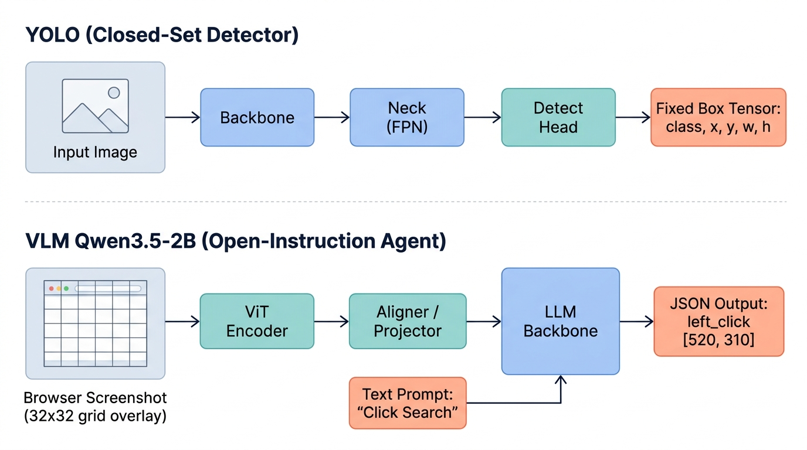
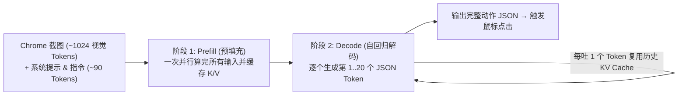
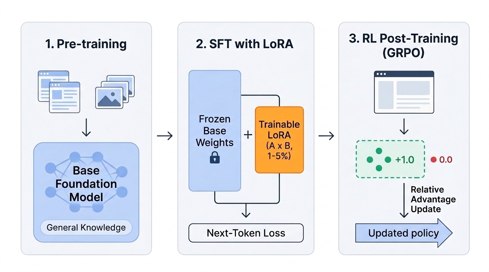
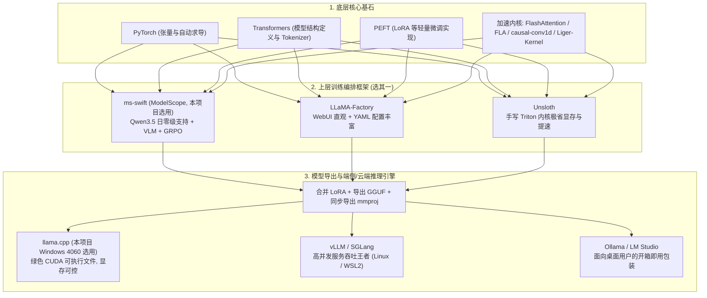
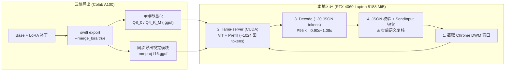

# LLM 与 VLM 训练全景教学手册：从原理、框架到本地快速推理

> **适用读者**：熟悉 YOLO 等经典视觉检测模型的训练，希望系统看懂 **大语言模型（LLM）** 与 **视觉-语言模型（VLM）** 内部是怎么工作的、主流微调与后训练框架各自管什么、以及如何把云端训好的模型压进本地 RTX 4060 Laptop。

---

## 一、底层核心逻辑：为什么 VLM 和 YOLO 长得完全不一样？

在 YOLO 里，网络更像一把“精密游标卡尺”：一张图进去，经过主干提取特征后，一次前向计算就并行吐出固定格式的回归张量 `[class_id, x, y, w, h]`。

而以 **`Qwen/Qwen3.5-2B`** 为代表的现代 VLM，本质上是一台**“能同时看懂像素和文字、并且按概率接龙写字的状态机”**。

### 1.1 一切的起点：万事万物皆 Token
* **文字怎么变成数字（Tokenizer 分词器）？**  
  模型不认识汉字或英文字母，它会先用词表把一段话切成一个个编号（Token ID）。例如：
  * `"left_click"` 可能被切成 2–3 个英文子词 Token；
  * `520` 在数字分词里通常只占 **1–3 个 Token**（比小数 `0.520418` 更短、更稳）；
  * 整个动作 JSON `{"action": "left_click", "coordinate": [520, 310]}` 大约只占 **20 个左右 Token**。
* **图片怎么变成“文字”（Visual Tokens）？**  
  在 `Qwen3.5` 里，一张 Chrome 截图会被按 **`32 × 32` 像素** 切成一个个小网格块。每个小块经过视觉编码器后，变成 **1 个视觉 Token**。  
  也就是说，对于后面的语言大脑而言，**1 张 `1280 × 800` 的浏览器截图 ≈ 前面排着 1,000 个“图像单词”，后面紧跟着你的文字问题**！

### 1.2 VLM 的三大模块如何配合？
1. **ViT Encoder（眼睛，约 306M 参数）**：负责把 `32×32` 的像素块压缩成高维特征向量，提炼按钮边框、图标形状、页面文字纹理。
2. **Aligner / Projector（翻译官）**：ViT 说着“视觉方言”，LLM 说着“语言方言”，Aligner 就是中间的同声传译，把视觉特征向量映射进 LLM 的词向量空间。
3. **LLM Backbone（大脑，混合注意力架构）**：
   * 传统 Transformer靠 **Self-Attention（自注意力）** 让每个 Token 去跟前面所有 Token 两两算相关性（就像你找“右上角红色关闭按钮”时，文字 Token 通过注意力去精准扫右上角的视觉 Token）；但标准注意力的计算量随序列长度呈 $O(N^2)$ 增长。
   * **`Qwen3.5-2B` 的特别之处**：它采用 **Gated DeltaNet（线性注意力）+ 经典注意力交替的混合架构**。线性注意力就像随身带着一块固定大小的“滑动笔记板”，扫描长序列时复杂度只有 $O(N)$、极省显存和算力，再隔几层穿插一次全注意力做全局精确对齐——这就是为什么需要安装 `flash-linear-attention` 和 `causal-conv1d` 这两个专属加速库。

---

## 二、推理为什么分“快慢两截”？看懂 Prefill、Decode 与 KV Cache

很多人奇怪：为什么昨天在 RTX 4060 Laptop 上，让模型吐 20 个字只要零点几秒，可把一张大图喂进去怎么要等接近 1 秒？秘密就在大模型推理的两阶段机制：

1. **Prefill（预填充，计算密集型 / 决定首字等待时间）**：
   * 刚收到截图和指令时，模型必须**一次性并行**把 ~1,100 个输入 Token 全部过一遍网络，顺便把每一层的中间状态 **K（Key）和 V（Value）** 存进显存（这就是 **KV Cache**）。
   * 昨天 M0 实测中，`llama-server`（`Q4_K_M`）把每次新图重算的这 ~1,000+ Token Prefill 加 20 个输出 Token 跑完，端到端 P95 只需 **`0.902s`**。
2. **Decode（解码生成，显存带宽密集型 / 决定吐字速度）**：
   * 吐出第 1 个字符后，接下来生成第 2、3……20 个字符时，**前面所有图像和提示词的 K/V 都已经在显存缓存里了**，每次只需算最新那 **1 个 Token** 与缓存的关系。
   * 因为每次只算 1 个 Token，算力几乎闲着，主要看显卡每毫秒能从显存里搬多少权重（**显存带宽**，这正是昨天说 A100 的 ~2 TB/s 带宽比 4060 Laptop 的 256 GB/s 快近 8 倍的根本原因）。
   * 也正因为 Decode 是按 Token 数量线性花时间，我们在本项目里**保持非思考模式、禁止模型解释原因、限制只吐短 JSON**——输出从 300 Token 压到 20 Token，生成阶段就直接快了 15 倍！

---

## 三、大模型训练三部曲：Pre-training → SFT → RL 后训练

把一个“刚出厂的原始权重”改造成“听懂指令、精准点击 Chrome 的特化专才”，现代大模型普遍经历三个阶段：

### 3.1 第一阶段：Pre-training（预训练，大厂完成）
* **干什么**：用数万亿级别的网页、书本、代码、图文对，让模型做最朴素的完形填空——**“给出前文，猜下一个 Token 是谁”**（Next-Token Prediction）。
* **产出物**：Base 基座模型。它博闻强识，但还不太懂“按你的对话格式听令行事”。我们使用的 **`Qwen/Qwen3.5-2B`** 已经由阿里官方完成了海量多模态预训练和基础指令对齐，天生具备识图、识字和基础空间定位能力。

### 3.2 第二阶段：SFT（Supervised Fine-Tuning，监督微调，我们的主力阶段）
* **核心原理**：还是 Next-Token 交叉熵损失（Cross-Entropy Loss），但有两条与预训练截然不同的铁律：
  1. **只对“助手回答”算 Loss（Label Masking）**：输入里的 `<system>`、`<image>` 和 `<user>` 提问全部设成忽略掩码（`-100`），**梯度只回传给标准答案 `{"action": "left_click", "coordinate": [268, 19]}` 这一段**。这样模型专心学“看见什么图+什么问题 → 该怎么回复”，不会把力气浪费在背你的提问上。
  2. **格式规训与领域适应**：原版模型其实看得懂图（M0 里它全点对了地方），但一会儿给你吐 `[{"target_id": ...}]`、一会儿只吐 `[111, 73]`。SFT 就像给模型上岗前培训：统一输出契约、关闭废话、并补齐它在预训练里很少见过的**中文网页和 Chrome 原生标签栏外壳**。

* **为什么微调要用 LoRA？（数学直觉一分钟看懂）**  
  原模型某一个线性层有个巨大的权重矩阵 $W$（比如 $2048 \times 2048$，共 400 万个参数）。直接改 $W$ 容易破坏原有知识且显存开销大。  
  **LoRA（Low-Rank Adaptation）** 的做法是把原矩阵 $W$ **完全锁死不改**，在旁边并联两个瘦长的小矩阵 $A$（$2048 \times r$）和 $B$（$r \times 2048$），前向传播变成：
  $$y = Wx + \frac{\alpha}{r}(B \cdot A)x$$
  * **`lora_rank (r=32)`**：决定旁路小矩阵有多宽（“外挂笔记本”有多厚）；
  * **`lora_alpha (64)`**：控制旁路改动对主干输出的放大权重（常见习惯取 `2 * r`）；
  * **`target_modules="all-linear"`**：不只给注意力层 `Q/K/V/O` 加旁路，而是给 LLM 所有的线性投影层（含 MLP、Gated DeltaNet 投影）都配上外挂小矩阵；
  * **⚠️ 常见认知纠偏**：
    * LoRA 只改 1%–5% 的参数，**但并不代表绝对不会过拟合**！如果数据过少、指令单一或训太多轮（比如按 YOLO 习惯跑几十轮），LoRA 一样会把坐标死背下来并损伤原本的识字泛化能力，因此本项目通常从 **`1~2 epochs`** 起步实验并按独立验证集挑最佳 checkpoint；
    * 在 `ms-swift` v4.x 中，`--tuner_type lora` 配合 `--freeze_vit false` 只是“允许对 ViT 也加 LoRA”，并不是像 YOLO 那样解冻原始主干；真想全参调视觉部分同时 LLM 用 LoRA，框架里对应的是 `--tuner_type lora_llm`。

### 3.3 第三阶段：RL 后训练（DPO / GRPO，把“像标准答案”变成“实战真点中”）
* **SFT 的天然短板**：SFT 要求逐字匹配。按钮中心是 `[500, 300]`，模型预测 `[512, 304]` 明明落在了按钮内部（实战 100% 成功），SFT 还是会惩罚它字符不对。
* **主流后训练方法对照**：
  | 方法 | 核心思路 | 显存与落地门槛 |
  | :--- | :--- | :--- |
  | **PPO**（早期 RLHF） | 需要同时在显存里塞进 Actor、Reference、Reward Model、Critic 4 个模型 | 太重，单卡民用/中小训练很难扛 |
  | **DPO**（直接偏好优化） | 准备“好回答 vs 坏回答”成对数据，不用在线采样直接对比拉大差距 | 省显存、稳定，但偏静态离线偏好 |
  | **GRPO**（群组相对策略优化） | 砍掉庞大的 Critic 价值网络！对同一张图**一次让模型猜 $G$ 个结果（如 4–8 次）**，用规则函数打分后，拿每条分数减去组内平均分得到相对优势（Advantage），鼓励高于组均分的做法 | **最适合客观可校验任务**（代码、数学、以及我们的 **点中 `bbox` 内即得 1 分**） |
* **⚠️ GRPO 的客观局限**：二值 `0/1` 奖励依赖“同一组采样里有对有错”。如果模型对某张图 8 次全对或 8 次全错，**组内相对奖励优势为零，策略损失就会缺少来自任务对错的有效学习信号**。所以工程上永远是先把工程坐标与 SFT 做好，再按实测决定是否需要小规模 GRPO 精修边界。

---

## 四、主流训练与推理框架全景地图

刚接触大模型生态最容易被几十个框架名字绕晕，其实把它们分层摆进一张表里就彻底透亮了：

| 层级 | 框架 / 工具 | 你怎么理解它的定位（类比 YOLO 生态） | 本项目选型与理由 |
| :--- | :--- | :--- | :--- |
| **底层模型库** | **`Transformers` + `PEFT`** | 就像 PyTorch + `torchvision` 基础模型定义 | 必装基座（本项目用 `transformers>=5.9` 对接 `Qwen3.5-2B`） |
| **算子加速层** | **`fla` + `causal-conv1d` + `Liger-Kernel`** | 就像针对新型卷积专门写的 CUDA 加速插件 | `Qwen3.5` 线性注意力必需，缺了训练会极慢 |
| **训练调度框** | **`ms-swift`**（阿里魔搭） | 就像 Ultralytics `yolo train` 主命令行管家 | **本项目选用**：对阿里自家的 Qwen3.5 混合架构与多模态 SFT/GRPO 支持最稳、参数体系最全 |
| **同类训练框** | **`LLaMA-Factory` / `Unsloth`** | 同类竞品训练脚手架（一个偏可视化全家桶，一个偏极致省显存内核） | 本项目先用 `ms-swift`；后续若本地 8GB 硬试训更小模型可参考 `Unsloth` |
| **端侧推理框** | **`llama.cpp` (`llama-server`)** | 就像训练完转成 `.engine` 给 TensorRT C++ 跑一样 | **本项目 Windows 4060 选用**：绿色免安装、`--mmproj`/`--reasoning off`/`--image-max-tokens` 全可控，昨晚实测稳跑 |
| **服务端推理** | **`vLLM` / `SGLang`** | 工业级高并发推理服务器（支持 PagedAttention 与连续批处理） | Colab M3/M5 大规模并发或 WSL2 高吞吐备选 |

---

## 五、最后一公里：合并、量化、`mmproj` 配套与本地闭环

1. **Merge LoRA（外挂合并回本体）**：  
   在 Colab 训练完，目录里默认只保存了一个几十 MB 的 LoRA 补丁（`adapter_model.safetensors`）。运行 `swift export --merge_lora true` 会执行数学合并 $W' = W + \frac{\alpha}{r}BA$，还原成完整模型，**这样本地推理时没有任何额外外挂计算开销**。
2. **为什么 GGUF 要拆成“主模型 + `mmproj`”两个文件？**  
   * 主文件（如 `m2-qwen35-2b-Q8_0.gguf`）里装的是语言大脑；
   * `mmproj`（如 `mmproj-m2-f16.gguf`）里装的是 **ViT 眼睛 + Aligner 翻译官**；
   * **绝对红线**：如果在 SFT 时开启过 `--freeze_vit false` 或 `--freeze_aligner false` 动了视觉侧，导出 GGUF 时**必须用同一个合并后的模型同步重新导出新的 `mmproj`**，绝不能拿新大脑配旧眼睛！
3. **量化精度怎么权衡（结合你本机 4060 Laptop 8188 MiB 实测）**：
   * `BF16`（主权重约 3.5 GiB + 637 MiB 视觉）：无损，但留给 Chrome 和上千上下文的缓冲略紧；
   * **`Q8_0`（主权重约 1.9 GiB + 637 MiB 视觉）**：几乎无损，昨晚本机实测峰值显存 **`3,608 MiB`**、端到端 P95 **`1.081s`**；
   * **`Q4_K_M`（主权重约 1.2 GiB + 637 MiB 视觉）**：极致省显存与极速，昨晚本机实测峰值显存仅 **`2,916 MiB`**、端到端 P95 **`0.902s`**。
   * 因此我们的 M2 硬门槛会直接拿同一批验证集对比 **合并后 BF16 vs Q8_0 vs Q4_K_M**，在精度不掉的前提下选最稳快的版本下放到你本机跑实战闭环！
