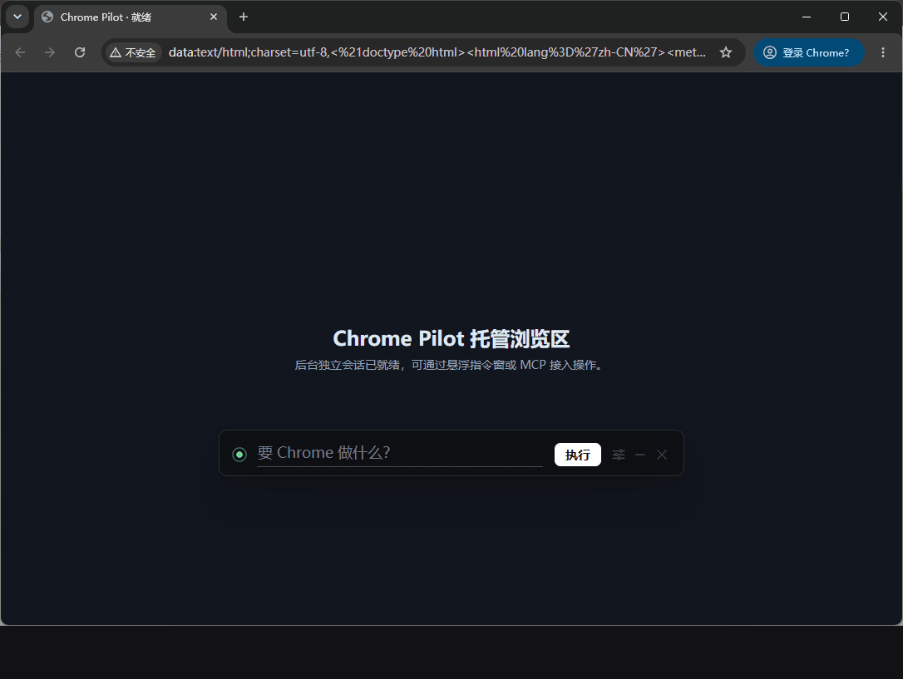

# Chrome CUA MCP

给没有内置 computer use 的 agent / harness 用的桌面操作工具（支持 Chrome 与通用 Windows 桌面应用）：一个 MCP 服务（v0.3.0），加一个本地 2B 视觉模型，加一个桌面悬浮窗。上层模型只收发文字，页面由本机来看、来点。



上面是 25 秒实录，未加速、未剪辑。一个 MCP 客户端用 `cua_navigate`、一次 `cua_run_steps`（4 步）和 `cua_ask_screen` 操作隔离的 Chrome，全程 0 张截图；随后在悬浮窗里输入“点击右侧橙色的按钮”，本地模型定位到的是“确认支付”，动作被拦下，人确认后才点击。页面是录制脚本自带的本地演示页，没有真实交易；底部字幕是后期加的，其中的耗时、字节数和回答取自当次调用的真实返回。录制脚本：[scripts/record_demo.py](./scripts/record_demo.py)。

## 它怎么工作

- **三种目标**
  - `managed`：独立配置目录的隔离 Chrome，通过 CDP 读 DOM、点元素。快，不碰你的日常浏览器。
  - `desktop`：你已经登录的本机 Chrome，用窗口截图、Windows 自带 OCR 和真实键鼠输入。
  - `os`：通用 Windows 桌面模式，可枚举并切窗控制任意可见桌面应用窗口（如 QQ、资源管理器、IDE）或全主屏（`hwnd=0`），支持 `drag` 拖拽及 `F1`–`F12`、`home`、`end`、`pageup`/`pagedown` 等扩展快捷键；遇 Electron 黑帧自动回退区域截屏。
- **文字优先**：能用 DOM 或 OCR 文字匹配的目标不调模型；默认不回传截图，返回体默认精简（`detail="brief"`）。
- **本地模型兜底**：没有文字的图标、需要“看一眼”的问题，交给本机的 Qwen3.5-2B 微调模型（`models/m4_gguf/` 优先，缺失时回退 `models/m35_gguf/`；llama.cpp，约 2.3 GB 显存），只把坐标或一句话答案返回给上层。模型在第一次用到视觉时才加载。
- **批量执行**：`cua_run_steps` 一次调用最多跑 12 步，减少上层模型的往返轮次。
- **保护**
  - 支付、下单、删除、转账等高危词（指令里出现，或定位到的目标上出现）会停下来等人确认，返回一次性 `confirm_token`。
  - 登录页和人机验证直接交还给人（Human-in-the-Loop）。
  - `desktop` / `os` 模式下目标窗口不在前台就拒绝发送键鼠（`hwnd=0` 全屏模式除外）；把鼠标甩到屏幕左上角可急停。
  - 带 `require_submit` 的提交步骤只认 URL 变化、明确的表单结果或你指定的新文字，输入框回显不算提交成功。
- **悬浮窗**：平时只有一行输入；上层接入、执行进度、12 秒无新动作自动收尾与玻璃风铃提示音（支持在 `assets/sounds/*.wav` 放置自定义音频）、风险确认按需出现。也可以不经上层模型，直接在里面下单步指令。

## 现状和边界

这是一个个人项目，只在一台机器上验证过（Windows 11、RTX 4060 Laptop 8 GB、Python 3.11）。下面的数字都是小样本，不是成功率承诺。

| 项目 | 结果 | 说明 |
| --- | --- | --- |
| 托管模式一次观察 | 2–3 ms | 不截图时 |
| 本地模型一次定位或读屏 | 约 0.5–0.7 s | 模型已加载（M4 实测约 0.63 s）；首次加载另需约 2–3 s，刚装完第一次用实测约 19 s（单次） |
| 桌面模式 OCR | 约 0.7 s | 整窗 |
| CN500 线上同批 50 站（M3.5 → M4） | 64% → 74%（`vlm_qa` 5/8 → 8/8） | 双通道 SFT 后真实站点通过率 +10pp，上层均值约 5,904 tokens/例 |
| `ask_screen` 未训练验证集（48 条，M3.5 → M4） | F1 0.216 → 0.581、长度合规 35% → 100% | 零 JSON 泄漏（0/48） |
| 静态留出集 Real222 / Venus320（M3.5 → M4） | 97.7% → 96.4% / 80.3% → 78.8% | 唯一轻微退化在 `not_found`（M4 略更敢点），落框精度反升（103 → 107） |
| Python 文档站内搜索并提交（托管模式） | 10/10 | 修复回车提交后复测 |

- **适合**：上层模型负责拆任务和核对结果，本工具负责按 DOM/OCR 执行；需要看图定位或跨应用操作时本地 M4 模型兜底；高危动作由人确认。
- **不适合**：无人值守的长链任务；纯视觉操作陌生网站；自动跳过登录门禁或人机验证（CAPTCHA）。
- **没有验证过**：除 Codex、Antigravity 以外的 MCP 客户端；上层模型实际节省了多少 token；Windows 10 和其他显卡。
- **视觉功能是可选的**：不装模型时，托管模式下按 DOM 操作网页照常可用；`cua_ask_screen`、`cua_locate` 和自然语言定位需要模型。

## 环境要求

- Windows 10/11，Google Chrome 装在默认位置（`C:\Program Files\Google\Chrome\Application\chrome.exe`）
- Python 3.11
- 视觉功能需要 NVIDIA 显卡（llama.cpp 的 CUDA 12.4 预编译包），约 2.3 GB 显存

## 安装

```powershell
git clone https://github.com/Assangejulian/chrome-cua-mcp.git
```

放在哪个目录都可以。然后双击文件夹里的 `setup.bat`，它会：

1. 在文件夹里建 `.venv` 并安装 [requirements.txt](./requirements.txt) 里的依赖；
2. 问你要不要装视觉模型。选是的话下载 llama.cpp 运行库（b12441，CUDA 12.4，约 0.7 GB）和[模型权重](https://github.com/Assangejulian/chrome-cua-mcp/releases/tag/m35-weights-v1)（约 1.9 GB），校验 SHA-256，占用磁盘约 4 GB；
3. 按文件夹现在的位置生成 MCP 接入配置，打印出来并写到 `configs/generated_codex.toml` 和 `configs/generated_stdio.json`。

可以重复运行：下载中断会续传，已完成的步骤会跳过；文件夹移动或改名之后再运行一次，就得到新路径的配置。不想被提问可以带参数：`setup.bat --with-model` 或 `setup.bat --no-model`。

手动安装等价于：

```powershell
py -3.11 -m venv .venv
.\.venv\Scripts\python.exe -m pip install -r requirements.txt
.\.venv\Scripts\python.exe .\scripts\install.py
```

模型放在 `models/m35_gguf/` 下（`m35-qwen35-2b-Q4_K_M.gguf` 和配套的 `m35-mmproj-f16.gguf`）。它是 `Qwen/Qwen3.5-2B` 的微调版本；官方基座不按本项目的动作协议输出，不能直接替代。

## 运行

**悬浮窗（同时提供 HTTP MCP，`http://127.0.0.1:18390/mcp`）**

```powershell
.\启动_Chrome_Pilot_M35.bat
```

悬浮窗启动时如果发现已打开的 Chrome，会默认选中“本机 Chrome”，之后的动作是真实键鼠输入到你的浏览器。想在隔离浏览器里操作，先点 ≡ 把第一个下拉切到“后台托管”。

**只起 MCP 服务（默认 `managed`）**

```powershell
.\.venv\Scripts\python.exe .\scripts\chrome_cua_mcp.py --stdio
.\.venv\Scripts\python.exe .\scripts\chrome_cua_mcp.py --http --port 18390
```

可选参数：`--target-mode managed|desktop|os`、`--profile-dir <目录>`（托管 Chrome 的配置目录，默认是项目下的 `profiles/cua_chrome`，里面有登录状态，已被 git 忽略）。

**接入上层模型**

Stdio 方式由上层模型自己拉起服务。配置里要写这个文件夹的绝对路径，所以不要手抄，用生成的：

```powershell
.\.venv\Scripts\python.exe .\scripts\chrome_cua_mcp.py --print-config codex   # 追加到 Codex 的 config.toml
.\.venv\Scripts\python.exe .\scripts\chrome_cua_mcp.py --print-config json    # 其他客户端用的 mcpServers JSON
```

`setup.bat` 结束时打印的就是这份内容；悬浮窗“接入”菜单里的“复制 Stdio 配置”也是按当前位置现生成的。

HTTP 方式连接已经在运行的悬浮窗或 `--http` 服务，与安装位置无关：

```json
{ "mcpServers": { "chrome-pilot-cua": { "url": "http://127.0.0.1:18390/mcp" } } }
```

## 工具

| 工具 | 作用 |
| --- | --- |
| `cua_navigate` | 打开网址、前进后退、切换标签页，枚举桌面窗口（`list_windows(all_apps=True)`）、聚焦窗口（`focus_window`）或切换 `managed` / `desktop` / `os`；返回标题、正文摘要和可点元素 |
| `cua_observe` | 读当前页面或桌面窗口：URL、标题、正文、可点元素（坐标为 0–1000 归一化）、是否遇到登录或验证码 |
| `cua_act` | 执行一步：按元素编号、OCR 编号、文字提示，或用自然语言交给本地模型定位 |
| `cua_run_steps` | 一次最多 12 步的小计划：打开、点击并输入、滚动到、等待、`drag` 拖拽、提问等；遇到弹窗、高危动作、未观察到提交会停下并说明 |
| `cua_ask_screen` | 让本地模型回答一个关于当前画面的事实问题，只返回文字 |
| `cua_locate` | 只预览本地模型的定位坐标，不发送任何输入 |
| `cua_dismiss_popup` | 尝试关闭弹窗或横幅 |
| `cua_extract` | 提取页面可见文字和链接 |
| `cua_status` | 当前模型、显存、浏览器和任务状态（不会触发模型加载） |
| `cua_task` | 把任务的开始、进度、完成显示到悬浮窗上 |

省上层 token 的用法：能拼出网址就直接 `cua_navigate`；多步操作打包进一次 `cua_run_steps`；需要确认页面细节时用 `cua_ask_screen` 而不是要截图；只有排查问题时才传 `include_screenshot=true` 或 `detail="full"`。`status` 只表示动作是否发出、提交是否被观察到，关键业务结果仍应由上层独立核对。

## 环境变量

| 变量 | 作用 |
| --- | --- |
| `CUA_PREWARM=1` | 第一次工具调用时就在后台加载本地模型。默认关闭：开启后首个视觉任务快约 1.7–2.6 s，但只做 DOM 的会话会白占约 2.3 GB 显存 |
| `CHROME_PILOT_MOTION=0` | 关闭悬浮窗动效 |
| `CHROME_PILOT_GLASS=0` | 关闭悬浮窗的半透明亚克力效果，改用不透明深色背景 |

## 测试

```powershell
.\.venv\Scripts\python.exe -u .\scripts\test_cua_mcp.py
```

全量回归约 2 分钟，需要先装好视觉模型；会启动一个隔离的 Chrome 和本地模型，覆盖 Stdio / HTTP 两种 MCP、提交判定、桌面 OCR、前台保护、悬浮窗交互与动效。界面相关的测试会短暂在屏幕上显示窗口；机器负载很高时，最后一项屏幕特效测试可能因超时失败，空闲时重跑即可。

## 模型训练

本地模型是 `Qwen/Qwen3.5-2B` 的 LoRA 微调（语言侧，监督微调），合并后导出为 GGUF（Q4_K_M）和配套的视觉投影文件。

- **M3.5**：训练集 4,148 条、验证集 645 条，在 Colab A100 上训练，输出单行 JSON 动作（`left_click`、`type`、`scroll`、`not_found` 等，坐标 0–1000 归一化）。
- **M4（双通道 SFT，当前默认）**：扩展至训练集 7,755 条、验证集 1,011 条（7 个数据源去重消歧），注入 `ask_screen` 短文本读屏问答样本（412 训练 / 48 验证）并保持动作 JSON 与纯文本问答零串台；在 Colab L4 上训练 486 步（`notebooks/M4_Colab_A100_Chrome_SFT.ipynb`），导出至 `models/m4_gguf/`。注：`setup.bat` 目前默认拉取已发布的 `m35-weights-v1` 权重包，若需使用 M4 可用上述 Notebook 自行导出或等待后续 `m4-weights-v1` Release。

- [01_任务书_Chrome视觉鼠标操作模型.md](./01_任务书_Chrome视觉鼠标操作模型.md)：最初的工程任务书（动作空间、坐标与 DPI 链路、数据规范、验收标准）。项目后来从“纯视觉模型”转向“DOM 优先、模型兜底”，任务书保留作为背景。
- [02_从YOLO到VLM后训练实战指南.md](./02_从YOLO到VLM后训练实战指南.md)、[03_LLM与VLM训练全景教学手册.md](./03_LLM与VLM训练全景教学手册.md)：写给有目标检测经验的人的 VLM 微调入门。
- [notebooks/](./notebooks)：数据准备和 Colab 训练、导出用的 Notebook；由 `scripts/build_colab_notebooks.py`、`scripts/m3_train_colab.py`、`scripts/m35_build_notebook.py`、`scripts/m4_build_notebook.py` 生成。
- `scripts/m1_*`、`m3_*`、`m35_*`、`m4_*`、`teacher_*`、`benchmark_cn500.py`：采集、Teacher 数据组装、离线对照和 CN500 端到端评测脚本。训练数据包和评测原始结果不在仓库里；M3.5 权重在 [Releases](https://github.com/Assangejulian/chrome-cua-mcp/releases/tag/m35-weights-v1)。

## 目录

```
scripts/cua_engine.py         引擎：托管 / 桌面两条路径、本地模型生命周期、提交判定、保护规则
scripts/chrome_cua_mcp.py     MCP 服务（Stdio 与 Streamable HTTP）
scripts/chrome_pilot_panel.py 悬浮窗
scripts/live_chrome_pilot.py  悬浮窗入口与 llama-server 启动
scripts/desktop_perceiver.py  桌面模式的 OCR 与画面感知
scripts/action_executor.py    带保护的真实键鼠执行
scripts/test_cua_mcp.py       全量回归
scripts/record_demo.py        录制上面的演示动图
setup.bat, scripts/install.py 一键安装：依赖、运行库、模型权重、接入配置
configs/                      MCP 接入配置模板；setup.bat 生成的 generated_* 是填好本机路径的版本
notebooks/                    训练与数据准备
```

`models/`、`tools/`、`artifacts/`、`profiles/` 是本机生成的目录，不入库。

## 许可证

代码以 Apache-2.0 发布，见 [LICENSE](./LICENSE)。Qwen3.5 基座模型和 llama.cpp 各有自己的许可证，使用前请分别查看。
